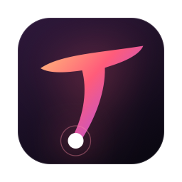
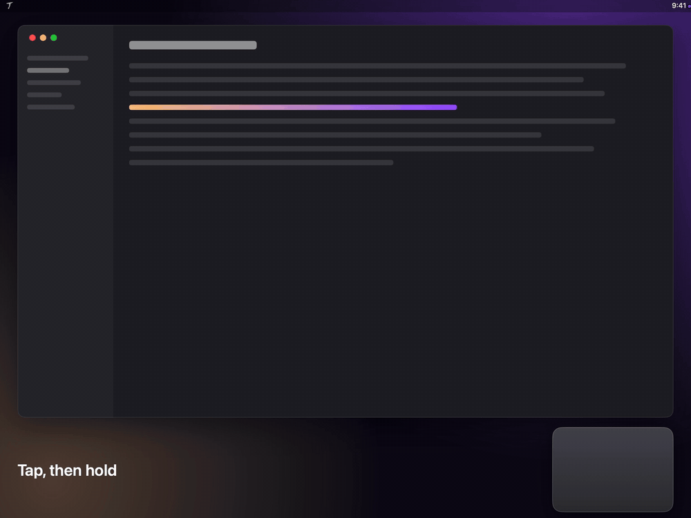

  

<h1 align="center">Nekro TouchOS</h1>

  <strong>A visual shortcut panel for your Mac trackpad. Summon a panel, point at a button by where your finger is on the trackpad, lift to run it.</strong>

  <a href="https://github.com/NekroAI/touchos/releases/latest">Download</a> ·
  <a href="docs/install.md">Install guide</a> ·
  <a href="README.zh-CN.md">中文</a>

  
  
  

  

> **Status: early release.** So far tested only on a Magic Trackpad with macOS 27. Built-in trackpads, Intel Macs and macOS 14–26 are unverified — reports welcome.

Trackpad gesture tools make you memorize a set of swipes. TouchOS shows your actions as a panel on screen and maps the trackpad onto it by position, so you look and pick rather than recall.

## Usage

1. **Tap, then hold.** Tap once with one finger and hold right after; the panel appears.
2. **Move your finger.** Its position on the trackpad selects a button.
3. **Lift to run.** Or press the trackpad to run and keep the panel open, or press and hold to repeat. Lifting away from any button just closes the panel.

While a panel is open, swipe two fingers up or down to switch panels, pinch to see them all, and hold the center close button to edit.

## Features

- **Panels** — any number, as grids (buttons can span cells) or rings, edited visually in Settings. Common, Window, Media and Numpad panels are included.
- **Actions** — keyboard shortcuts, typing text, opening apps / URLs / files, shell commands, AppleScript, Shortcuts, media and system controls, window placement, and volume and brightness sliders.
- **Triggers** — tap-then-hold, three- or four-finger tap, or tap-then-hold from a corner or edge of the trackpad. Enable several and bind each to its own panel.
- **Appearance** — three themes, with your choice of accent color and panel transition.
- **Configuration** — a JSON file at `~/Library/Application Support/TouchOS/config.json` with automatic backups, import / export and optional iCloud sync. Scripts in an imported configuration must be confirmed one by one.
- **Also** — per-app exclusions; English and Simplified Chinese.

## Install

Download the DMG from [Releases](https://github.com/NekroAI/touchos/releases/latest) (`macOS-arm64` for Apple silicon, `macOS-x64` for Intel) and drag **TouchOS** into Applications.

**Requirements:** macOS 14 or later and a Force Touch trackpad (built-in, or Magic Trackpad 2 or later).

TouchOS is self-signed and not notarized by Apple, so macOS blocks the first launch: open **System Settings → Privacy & Security** and click **Open Anyway**. Details in the [install guide](docs/install.md).

Turning off the system's "Tap to Click" is recommended; otherwise the first tap of tap-then-hold also clicks.

## Permissions and privacy

- **Accessibility** — used to hold the cursor still while a panel is open, send keyboard shortcuts and place windows.
- **Touch data** — processed in memory only; never logged, stored or uploaded.
- **Network** — the only request is a daily version check against GitHub Releases, carrying no touch or configuration data. It can be turned off in Settings.

## Compatibility

Trackpad contacts are read through MultitouchSupport, a private framework built into macOS (not a third-party component), because public APIs don't expose absolute finger positions. As a result, TouchOS can't be distributed on the Mac App Store, and a major macOS update may stop it working until it's adapted; the trackpad itself keeps behaving normally in that case.

## Build from source

See [CONTRIBUTING.md](CONTRIBUTING.md). Design documents (in Chinese) live in [`docs/`](docs/README.md).

## License

[GPL-3.0-or-later](LICENSE)
