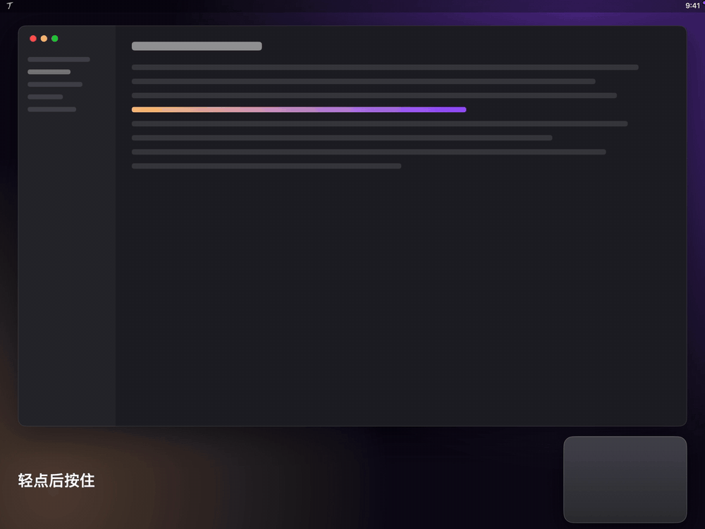

  

<h1 align="center">Nekro TouchOS</h1>

  <strong>触控板上的可视化快捷面板。唤起面板，手指在触控板上的位置直接指向按钮，抬起即执行。</strong>

  <a href="https://github.com/NekroAI/touchos/releases/latest">下载</a> ·
  <a href="docs/install.md#安装-nekro-touchos">安装说明</a> ·
  <a href="README.md">English</a>

  
  
  

  

> **状态：早期版本。** 目前只在妙控板 + macOS 27 上测试过，内置触控板、Intel Mac 和 macOS 14–26 尚未验证，欢迎反馈。

触控板手势工具要你记住一套划法。TouchOS 把动作显示成屏幕上的面板，触控板与面板按位置一一对应：看着选，不用记。

## 用法

1. **轻点后按住**：单指轻点一下，紧接着按住，面板出现。
2. **移动手指**：手指在触控板上的位置决定选中哪个按钮。
3. **抬起执行**：也可以按下触控板执行并保留面板，或按住连续触发。在按钮之外抬起则直接关闭。

面板打开时，双指上下滑动切换面板，双指捏合总览全部面板，在中央的关闭按钮上按住进入编辑。

## 功能

- **面板**：数量不限，支持网格（按钮可跨格）和环形布局，在设置中可视化编辑。默认提供常用、窗口、媒体、数字键盘四个面板。
- **动作**：快捷键、输入文字、打开应用 / 网址 / 文件、Shell 命令、AppleScript、快捷指令、媒体与系统控制、窗口摆放，以及音量、亮度滑杆。
- **唤起方式**：轻点后按住、三指或四指轻点、从触控板的角或边开始的轻点后按住；可同时启用多种，分别绑定不同面板。
- **外观**：三套主题，强调色与面板切换动画可自选。
- **配置**：JSON 文件存放在 `~/Library/Application Support/TouchOS/config.json`，自动备份，支持导入导出和可选的 iCloud 同步。导入配置中的脚本需要逐条确认。
- **其他**：按应用排除、中英双语。

## 安装

在 [Releases](https://github.com/NekroAI/touchos/releases/latest) 下载 DMG（Apple 芯片选 `macOS-arm64`，Intel 选 `macOS-x64`），把 **TouchOS** 拖进「应用程序」。

**系统要求：** macOS 14 及以上；力度触控板（内置，或妙控板第二代及以后）。

TouchOS 使用自签名证书，未经 Apple 公证，首次打开会被拦截：到 **系统设置 → 隐私与安全性** 点 **仍要打开**。详见[安装说明](docs/install.md#安装-nekro-touchos)。

建议关闭系统的「轻点来点按」，否则轻点后按住的第一下会先点击一次。

## 权限与隐私

- **辅助功能权限**：用于在面板打开时暂停光标、发送快捷键和摆放窗口。
- **触控数据**：只在内存中处理，不记录、不存储、不上传。
- **网络**：唯一的请求是每天向 GitHub Releases 查询一次新版本，不包含触控或配置数据，可在设置中关闭。

## 兼容性

读取触控板触点使用的是 macOS 系统内置的私有框架 MultitouchSupport（不是第三方组件），因为公开接口无法提供手指的绝对位置。这意味着 TouchOS 无法上架 Mac App Store，系统大版本更新也可能导致它暂时无法使用，需要等待适配；此时触控板本身的行为不受影响。

## 从源码构建

见 [CONTRIBUTING.md](CONTRIBUTING.md)。设计文档在 [`docs/`](docs/README.md)。

## 许可证

[GPL-3.0-or-later](LICENSE)
